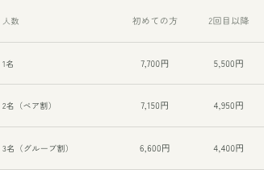
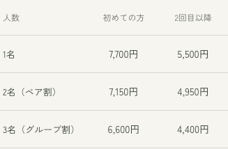
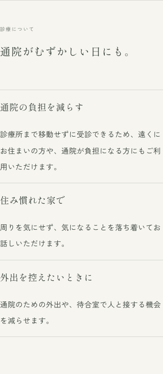
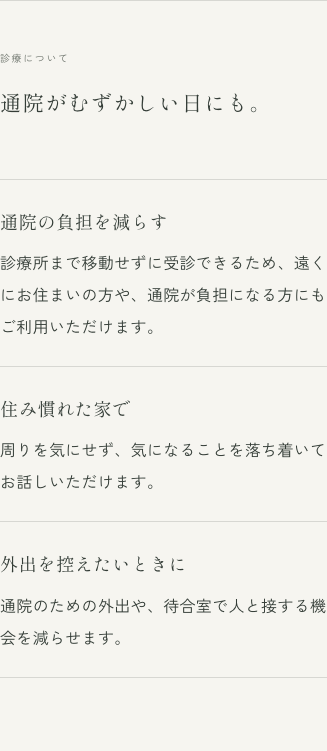
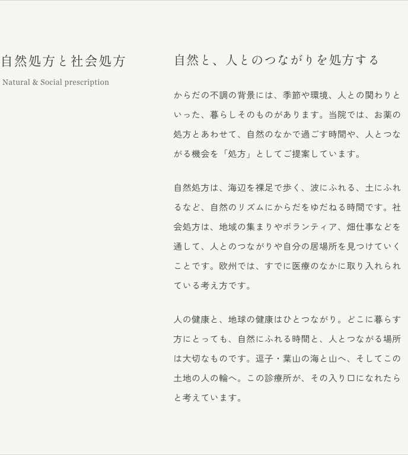
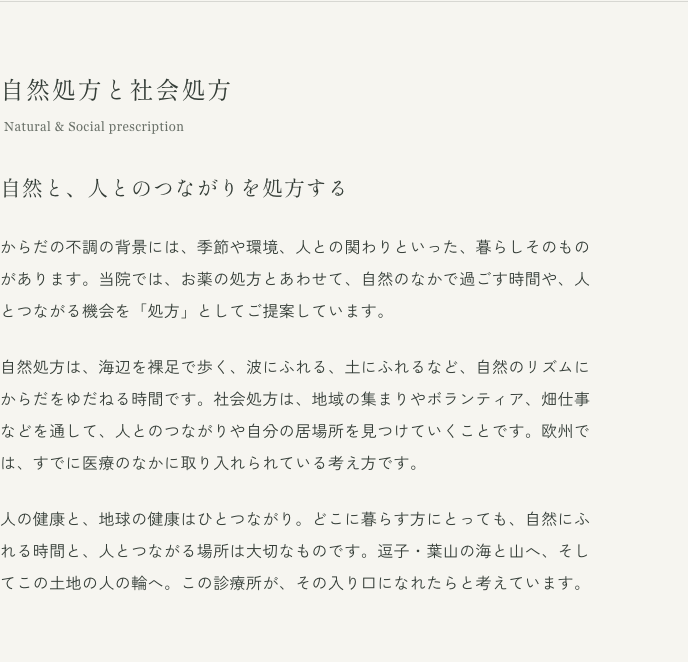

# 廣瀬診療所｜文章と見た目の比較案

2026年10月12日・初回の比較案（検討履歴）

**採用状況：** D01・D02は16px指定、D05〜D12・D14〜D16を採用。身土不二は追加のC案とPC中央配置を採用。D03は既存配置を確認して維持、D04は保留、D13は元の速度を維持。W・Fは未採用の宿題。以下の前後比較は最初の提案時点の記録で、現在の採用結果はimplementation.mdとMAP.mdを参照。

MAP.md全体、前回の比較案の引き継ぎ、公開サイトの正式10ページと旧preview、共通メニュー・フッター・検索／共有文を確認しました。OCEANの関連する理念の記録と、過去チャットの本人の言葉も照合しました。

いまのサイトには、本人撮影の風景、紙色、明朝体、縦書き、細い罫線というよい土台があります。私の推奨は、ここを生かしながら「読める大きさ」「同じ話が近くにある配置」「言い過ぎない具体的な日本語」を整えることです。

以下は最初に提示した提案の記録です。「先に直す候補」は読みやすさ・案内の明確さ、「比較して選ぶ／好みで選ぶ」は美意識や声の選択、「確認事項」は事実を確かめてから決める項目です。全55項目を一括で変える提案ではありません。

サイトの文章・表示設定・写真は変更していません。前後の画像は、比較用のブラウザーだけに仮の表示設定を当てて撮影しました。

## 残す土台

- 本人撮影の富士山・江ノ島・海と山、室内の写真。紙色・松葉色・細い罫線。

- 表紙中央の小さな縦書き「廣瀬診療所」と、その下のHIROSESHINRYOJO。

- 表紙写真の下、白い背景に置く縦書き2列の詩。2列目を下げる配置。

- 「この土地と生きる」「身土不二」「港」「Sense of wonder」。

- 「Grounding in the rhythms of nature」「Yoga & Meditation」。

- 「西洋医学と東洋医学」「代表／医師」「瞑想」「脈と舌と腹部を診察し」。

- PCの広い端、本文約36字、両端揃え、追従する見出しという前回の選択。

- 長沢哲夫の詩と作者表記。今回、新しい詩句の転載や文言変更はしない。

## 薫さんらしい言葉の基準

- 本人の過去の要件：「簡潔で詩的」「感覚的・体感的な描写」「横に並ぶ距離感」「押しつけ・煽り・過度な感情表現を避ける」「効果効能を約束しない」。SNS用の要件をサイトにも生かす編集提案です。

- OCEANの日誌から整理できる核は、からだ・日々の暮らし・土地・人とのつながりを一つとして考えること。診療と自然の活動は同じライフワークの延長です。この整理はAIによる要約で、確定した本人の理念文そのものではありません。

- 和の余韻は、実際の景色、短い言葉、沈黙を置ける余白から作る。静かな癒やしだけへ寄せず、歩く・人とつながる・地域と生きる姿も伝える。

- 詩や短い見出しには余韻を、説明本文には具体的な動作を、日時・費用・予約には明快さを持たせる。ひとつの段落では比喩を重ねすぎない。

## 画面の前後比較

### D01 料金表

375px幅。左が現状、右が金額14px・項目13pxの案。

現状

修正案（未反映）

### D02・D04 見出しと本文

375px幅。左が現状、右が見出し直下8px・本文16pxの案。文章は同じ。

現状

修正案（未反映）

### D03 タブレット

768px幅。左が現状の2列、右が1列・本文最大600pxの案。文章は同じ。

現状

修正案（未反映）

## 見た目の候補

### D01｜スマホの料金表を読みやすくする

判断：先に直す候補

場所：アクセス／裸足ハイク／サーフセラピー、globals.css .schedule-table

**現状**

参加費・キャンセル規定の表は11px、最初の列は10px。375px幅でサーフセラピーの金額は11px。

**修正案**

金額14px、項目13px、列見出し12〜13px。項目名は必要に応じて2行、金額は1行。診療時間の曜日表は別の設定にする。

**理由・留意点**

お金や参加条件は読み落としなく伝える。控えめな罫線と余白を残したまま、文字を大きくできる。3列のサーフセラピー表で比較済み。裸足ハイク表やキャンセル表は採用後に個別確認する。

### D02｜小見出しと説明を近づける

判断：先に直す候補

場所：オンライン診療、globals.css .rule-list > li > h3／.steps > li > h3

**現状**

スマホでは、オンライン診療の小見出しと説明の間に22pxの余白。PCでは案内リスト6px、手順4px。

**修正案**

小見出しと説明の間は8〜12px。項目同士の余白は24〜32pxを保つ。

**理由・留意点**

同じ話の見出しと本文を近づけ、別の話との間を広くする「近接」の原則。余白の量を減らすより、意味を分ける。比較画像では本文16px案も併用。

### D03｜狭いタブレットの2列を見直す

判断：比較して選ぶ

場所：全ページの節、globals.css .editorial-section／.about-page

**現状**

768px幅でも左見出し・右本文の2列。本文欄は約396px、見出し欄は約247px。

**修正案**

701〜899px程度は1列にして、本文は最大600px程度。900〜1023pxは見出しと本文の幅を見て2列にする案と比較する。

**理由・留意点**

タブレットでは、本文のために使える幅に対して左欄が大きい。1列案は内容を追いやすい。境目の900pxは仮の目安で、固定のデザイン法則ではない。768pxの比較のみ作成済み。

### D04｜スマホ本文の基準を16pxにする

判断：比較して選ぶ

場所：全ページの本文、globals.css .prose／.intro-copy

**現状**

本文は375px幅で15px、320px幅で14px。行高はそれぞれ32.25px・30.1px。PCは16px・32.8px。

**修正案**

スマホ本文16px、行高31〜33pxを出発点に比較。PC通常本文16px・冒頭の明朝17pxは現行を維持。通常本文17px案は必要なページだけ比較する。

**理由・留意点**

小さな端末ほど文字が小さくなる現在の設定を見直す。文字を大きくすると縦に長くなるため、同時に段落を短くし、行間を過剰に広げない。16pxはこのサイトへの提案値。

### D05｜日程・住所・電話の文字を本文に近づける

判断：先に直す候補

場所：アクセス／両フィールドワーク、globals.css .detail-list

**現状**

スマホの詳細欄は13px、左の項目名は11px。住所や開催日、電話番号も小さめ。

**修正案**

重要な値は14〜15px、項目名は12〜13px。長い「お問い合わせ」は1列表示も比較。

**理由・留意点**

本文より、受診や参加に必要な情報のほうが小さく見える。情報の重要度と文字の大きさを合わせる。

### D06｜小さな補足の役割を分ける

判断：先に直す候補

場所：HomeHero／Footer／quiet-note／hero-bottom

**現状**

スマホの表紙下「完全予約制」10px、電話受付などの補足12px、フッターの公式LINE10px。

**修正案**

完全予約制・電話受付・住所連絡の説明は12〜14px。写真の注記や英字の屋号は控えめな現状を基準にする。

**理由・留意点**

全ての小文字を同じ大きさにするより、読み取る必要がある情報を優先する。写真上の文字は画像の明暗も個別に見る。

### D07｜スマホの見出し階層をそろえる

判断：先に直す候補

場所：news/page.tsx／globals.css .article-title／.page-intro h1

**現状**

320pxのお知らせはページ見出し22px、記事見出し23pxで大小が逆転。イベント内の節見出しは18px。

**修正案**

お知らせの記事見出しだけ20〜21px案にする。通常のページ見出し・節見出しはまず現行を維持。本文を16pxへ拡大する案を選んだ場合は、関連する見出しも実画面で再比較する。

**理由・留意点**

お知らせの記事用のスマホ調整が当たっていない取り残し。通常ページの小さめの見出しは本人が選んだため、一緒に大きくしない。トップの縦書き屋号や詩は別枠。

### D08｜本文の行の長さをそろえる

判断：比較して選ぶ

場所：ニュース／裸足ハイク／globals.css .prose

**現状**

PCの通常本文は最大約605px（約36字）。お知らせ本文は720pxまで広がり、裸足ハイクの説明も別の幅になる。

**修正案**

読む文章の幅は約580〜640pxを基準にする。料金表・写真・一覧の幅は用途に合わせて保つ。

**理由・留意点**

同じ文字でも、行の長さが変わると読むテンポが変わる。現在採用済みのPC16px・約36字を出発点にそろえる。

### D09｜固定改行を文章の役割に合わせる

判断：比較して選ぶ

場所：page.tsx／LineText／text-unit／desktop-break

**現状**

トップの本文にはPCだけの固定改行と、意味ごとの折り返し指定が多い。

**修正案**

詩や短い見出しは意図した改行を残す。説明の段落は基本的に画面幅で折り返し、どうしても必要な箇所だけ固定する。

**理由・留意点**

文章を直したときにも一行だけ短く残らないようにする。意味のまとまりを守る設定は既にあるので、全面的に外す必要はない。

### D10｜縦書きと横書きの読み順を保つ

判断：基本は維持・必要箇所のみ比較

場所：トップ／aboutの冒頭／裸足ハイク

**現状**

PCのトップ見出し3つ、身土不二、裸足ハイクの詩・結びは縦書き。本文・実用情報は横書き。スマホの身土不二は縦の題と横の本文。

**修正案**

縦書きは短い見出しや詩に絞る現行を維持。縦の見出しの頭と横の本文の最初の行をそろえ、余白を一定にする。スマホの身土不二は現行と、横本文を左揃えにする案を比較。

**理由・留意点**

混在そのものは問題ではない。方向が変わる所に適切な余白を置き、どこから読むかを明確にする。右揃え・縦書きは直近の本人選択なので再選択は任意。

### D11｜詩の字間と散らし書きは微調整にとどめる

判断：好みで選ぶ

場所：globals.css .home-poem／.editorial-section--tate

**現状**

トップの詩はPC24px・字間0.32文字分、スマホ19px・0.24文字分。PCの縦見出しは30px・字間0.28文字分。

**修正案**

現行を基準に、縦見出しの字間0.18〜0.24文字分の案を比較。詩の2列・2列目を下げる配置は維持する。

**理由・留意点**

字間を広げすぎると、一つの言葉を一字ずつ追う感じになる。侘び寂びの余韻は、字間だけでなく周囲の空間でも作れる。規則違反という指摘ではない。

### D12｜大きな余白と小さな余白のリズムを整理する

判断：比較して選ぶ

場所：全ページ／フッター／home-poem

**現状**

PCの節は上下各112px、スマホは各48px。トップの詩、導入、写真、全ページ共通の夕景にも大きな間がある。

**修正案**

PCの節は現行を基準に96〜112px、スマホは48〜64px。詩や景色の余白は残し、短い実用案内は詰める案を比べる。

**理由・留意点**

余白を全て同じにするより、読む・眺める・申し込む場面の違いを伝える。特に短い一覧とお知らせでは、夕景が本文より大きく感じられるため好みで比較する。

### D13｜表紙の案内が現れる時間を再比較する

判断：好みで選ぶ

場所：globals.css hero-wordmark-reveal／hero-text-reveal

**現状**

屋号は約0.35秒後から4.2秒で表示。メニューや下部案内は4.9秒後から表示される。動きを減らす設定とキーボード操作時の配慮はある。

**修正案**

屋号のゆっくりした表示は維持し、メニューや予約案内だけ最初から見せる案と現行を比較。

**理由・留意点**

初めて来た人が予約を探す場面では待ち時間になる。一方、現在の速度は本人の選択。動作不良として扱わず、風景への没入と用件の見つけやすさを比較する。

### D14｜書体の役割を固定する

判断：基本は維持

場所：layout.tsx／globals.css／HomeHero

**現状**

見出し・詩は明朝、通常本文はゴシック。PCの冒頭説明は明朝17px、英語はGeorgia。表紙の屋号は端末の明朝が優先される。

**修正案**

この使い分けを維持。PCの長い説明はゴシック、短い理念は明朝。表紙の屋号のみMacとスマホ実機で見比べ、差が気になる場合に書体統一案を出す。

**理由・留意点**

和の雰囲気を出すために全て明朝にすると、料金や連絡先が読みにくくなり得る。英語や屋号は装飾の役割があるので、本文の物差しへ無理にそろえない。

### D15｜色と写真は現行を生かす

判断：基本は維持

場所：globals.css／photos／Header／Footer

**現状**

紙色#f6f5f0、本文#343d37、補足#697068、松葉色の印、本人撮影の朝夕の風景と室内。

**修正案**

基本の色・写真・細い罫線を維持。新しい和柄や筆文字を足さず、文章の密度と余白を整える。小文字と写真上の白文字のみ読みやすさを再確認。

**理由・留意点**

固定の紙色に対する本文と補足の明暗差は良好。全てを薄くすることが侘び寂びではない。現在の実写に土地と時間の変化が既にある。

### D16｜質問の回答とトップの行き先リンク

判断：先に直す候補

場所：online-consultation FAQ／トップの診療リンク

**現状**

オンライン診療の質問回答はスマホ13px・PC14px。トップの行き先リンクはスマホでも20px固定。

**修正案**

回答はスマホ15px・PC16px。トップの行き先は18〜19px案を比較し、押せる範囲の上下余白は維持する。

**理由・留意点**

質問の答えは受診に必要な本文なので、小さくしすぎない。見出し・行き先・補足の大小は役割に合わせる。

## 文章の候補

### W01｜トップの最初の見出し

判断：好みで選ぶ・直近採用済み

場所：トップ「診療所のこと」

**現状**

日々のなかに、
からだがある。

**修正案**

推奨案：からだを診る。
暮らしに目を向ける。

余韻を多く残す案：からだと、
日々の暮らしを。

**理由・留意点**

現行は詩的だが、診療の姿勢が少し遠回り。診察と生活をつないで診ることを一段具体的にできる。縦2列の長さも見て選ぶ。現行維持も十分にあり。

### W02｜食事の問いを短くする

判断：軽い修正候補

場所：トップ・最初の本文

**現状**

よく眠れているか。食事をおいしく食べられているか。

**修正案**

よく眠れているか。
おいしく食べられているか。

**理由・留意点**

「食事を」「食べる」の重なりを除く。暮らしの具体的な問いと、短い行の語感は残せる。

### W03｜「小さな迷い」の意味を具体的にする

判断：好みで選ぶ・直近採用済み

場所：トップ「一人ひとり、ゆっくりと。」

**現状**

からだの不調も、暮らしのなかの小さな迷いも、どうぞ急がずにお話しください。

**修正案**

からだの不調も、日々の暮らしで気になっていることも。どうぞ急がずにお話しください。

**理由・留意点**

「迷い」は人生全般の相談まで含むようにも読める。診察で伺う暮らしの話へ近づけ、柔らかさは保つ。

### W04｜足の裏の感覚を、具体的な描写へ

判断：好みで選ぶ・直近採用済み

場所：トップ「足もとから、自然にふれる。」

**現状**

靴を脱いで砂の上に立つと、ふだん忘れている足の裏の感覚がよみがえります。

**修正案**

靴を脱いで、砂の上に立つ。
足の裏に、砂のやわらかさが伝わります。

**理由・留意点**

読者が何を忘れているかを決めず、実際に感じるものを描く。体験の押しつけを弱める小さな編集。

### W05｜「この土地と生きる」の話の順序

判断：比較して選ぶ・見出しは維持

場所：about #grounding

**現状**

救急医療の経験 → 漢方を学んだ経緯 → 逗子の景色と「港」の願い。

**修正案**

推奨案：逗子の景色と「港」の願い → 救急医療の経験 → 漢方を学んだ経緯。

別案：土地の段落をこの節に残し、医療の経緯2段落を医師紹介へ移す。

**理由・留意点**

本人が選んだ見出しへ最初の段落からつながる。移動の少ない推奨案から比較できる。文章そのものを全て新しくする必要はない。

### W06｜医師の姿勢を抽象的な言い回しから具体化する

判断：好みで選ぶ・直近採用済み

場所：about #grounding の2段落目

**現状**

検査の数値だけでなく、体質や暮らしぶり、心の状態までを見渡し、季節や環境とともに移り変わるからだの声に耳を傾ける。いまの診療で、何より大切にしていることです。

**修正案**

検査の結果に加えて、体質や日々の暮らし、心の状態も伺います。季節や環境によって変わる不調を、丁寧に診ていきたいと考えています。

**理由・留意点**

「見渡す」「からだの声」「何より大切」が重なる箇所。具体的に何を聞き、どう診るかへ近づける。トップの詩には「からだの声」を残す。

### W07｜自然処方の小見出しを短くする

判断：好みで選ぶ・今日採用済み

場所：about #prescription

**現状**

自然と、人とのつながりを処方する

**修正案**

海や山へ、人の輪へ。

**理由・留意点**

節タイトルの「処方」をもう一度説明する代わりに、向かう場所を描く。医師が自然との触れ合いを処方する本人の意図は本文に残す。現行の力強さを好むなら維持。

### W08｜自然処方と社会処方の説明を分ける

判断：比較して選ぶ・今日採用済み

場所：about #prescription の2段落目

**現状**

一つの長い段落の中で、自然処方、社会処方、欧州の医療の説明が続く。自然処方は「自然のリズムにからだをゆだねる時間」と説明。

**修正案**

自然処方は、海辺を裸足で歩く、波にふれる、土にふれること。自然を感じながら、からだを動かす時間をご提案します。

社会処方は、地域の集まりやボランティア、畑仕事などを通して、人とのつながりや居場所を見つけていく考え方です。

**理由・留意点**

静かに身をゆだねる面に加え、歩く・動く・人と関わる面を伝える。自然処方と社会処方を2段落に分ける案。欧州の一文はW09と一緒に選ぶ。

### W09｜欧州の説明の範囲を明確にする

判断：事実と意図を確認して選ぶ

場所：about #prescription／NHS Social prescribing

**現状**

欧州では、すでに医療のなかに取り入れられている考え方です。

**修正案**

欧州表記を残す案：欧州では、人を地域の活動やつながりへ結ぶ「社会処方」を、医療に取り入れる動きが広がっています。

短くする案：この一文を省き、当院が大切にしていることへつなぐ。

**理由・留意点**

現行では自然処方・社会処方の両方、欧州全域を指すようにも読める。NHS一次資料で英国の取り組みは確認できる。欧州表記は今日の本人指定なので、地理を無断で英国へ戻さない。欧州全体の動きを書く案は地域別根拠の追加確認後に採用する。

### W10｜プラネタリーヘルスを理念の言葉として整理する

判断：構成を比較して選ぶ

場所：about #prescription／今後の理念項目

**現状**

人の健康と、地球の健康はひとつながり。
（自然処方と社会処方の本文に含まれる）

**修正案**

推奨案：この一文を残し、同じ節の中で「人と自然、ともに健やかに。」という短い小見出しで整理する。

独立した節を作る場合の導入案：人の暮らしは、海や山、土や水の営みとつながっています。人の健康と、自然の健やかさをともに考えることを、診療とフィールドワークの土台にしています。

**理由・留意点**

OCEANの記録では診療と活動は一つのライフワーク。新しい資格や効能の説明として足すより、同じ願いから生まれた活動と伝える。独立した節の追加はまだ未決。

### W11｜ヨガの実施状況と案内先をそろえる

判断：実施状況の確認後に採用

場所：about #yoga／events 一覧

**現状**

診療とは別に、ヨガと瞑想の指導やワークショップも行っています。
リンク先はフィールドワーク2件の一覧で、ヨガの開催案内はない。

**修正案**

定期・個別に実施している場合：診療とは別に、ヨガと瞑想の指導も行っています。開催予定やご相談は、公式LINEへお問い合わせください。

企画中の場合：ヨガと瞑想のワークショップは、開催が決まり次第ご案内します。

**理由・留意点**

すでに行っていることと、これから始めることを読み分けられるようにする。新しい開催実績をAIが作らない。導線の変更は実際の受付方法を確認してから。

### W12｜診療案内の冒頭を明快にする

判断：先に直す候補

場所：services の冒頭

**現状**

保険診療と自費診療（自由診療）を組み合わせながら、症状や体質、日々の暮らしに合わせた診療をご提案します。

**修正案**

症状や体質、日々の暮らしを伺いながら、診療をご提案します。診療内容により、保険診療または自由診療（自費診療）となります。

**理由・留意点**

「組み合わせながら」は費用の区分を読み取りにくい。診療の姿勢と費用区分を別の文にする。保険／自由診療の運用自体は変更しない。

### W13｜救急対応の見出しと完全予約制の関係

判断：確認してから比較

場所：services #general

**現状**

総合内科・救急対応

**修正案**

見出し案：総合内科・けがの初期対応

別案：現行見出しを保ち、予約・受入可能な範囲を本文に明記する。

**理由・留意点**

突然行けば救急外来として受け入れると読まれる可能性がある。救急科専門医としての経験と現在の診療所の受付体制を分けて伝える。対応範囲の新しい条件は、本人確認なしに足さない。

### W14｜漢方の診察を同じ動詞で伝える

判断：軽い修正候補

場所：services #kampo

**現状**

こうしたお悩みを伺い、漢方の視点から体質やからだの状態を見つめます。

**修正案**

こうしたお悩みを伺い、漢方の視点から体質やからだの状態を診ていきます。

**理由・留意点**

「見つめる」より、医師が診察することが明確になる。本人が指定した「脈と舌と腹部を診察し」はそのまま残す。

### W15｜暮らしの相談を具体的な案内へ

判断：好みで選ぶ・直近採用済み

場所：services #lifestyle

**現状**

食事や睡眠を振り返り、瞑想やヨガなど、ご自宅でも続けられる方法をご案内します。ご自身にも環境にもやさしい暮らし方を、ご自分のペースで探していきましょう。

**修正案**

食事や睡眠のことを伺い、瞑想やヨガなど、日々の暮らしで取り入れられる方法をご案内します。無理なく続けられる養生を、ご自身のペースで考えていきます。

**理由・留意点**

「環境にもやさしい」が何を指すかは現在の本文では分かりにくい。環境への姿勢は理念の節で具体化し、診療案内は実際に相談する内容を中心にする。

### W16｜オンライン診療の準備中表示を短くする

判断：先に直す候補

場所：online-consultation 冒頭

**現状**

オンライン診療は現在、システム構築中です。準備が整い次第、開始時期やご利用方法をご案内します。

**修正案**

オンライン診療は、現在準備中です。開始時期やご利用方法は、準備が整い次第ご案内します。

**理由・留意点**

作っている仕組みの説明より、読者が知りたい受付状況を先に伝える。現在の準備中の状態は維持。

### W17｜オンライン診療の見出しを実用情報に合わせる

判断：好みで選ぶ

場所：online-consultation 各節

**現状**

通院がむずかしい日にも。
ご予約から、お薬まで。
受診の前に、ご確認ください。

**修正案**

オンライン診療について
ご利用の流れ（予定）
よくあるご質問

**理由・留意点**

ページ冒頭の「いつもの場所で、診療の時間を。」に余韻を残し、下の案内を探しやすくする案。すべての見出しを詩的にする必要はない。

### W18｜オンライン診療の未確定な費用・アプリ

判断：事実確認後に採用

場所：online-consultation FAQ／ご利用の流れ

**現状**

通常の診察料に加え、システム利用料（事務手数料）が必要となります。詳細は予約時にご確認ください。
専用アプリのインストールをお願いする場合がございます。

**修正案**

費用が未確定の場合：費用やお支払い方法の詳細は、受付開始前にご案内します。

アプリが未確定の場合：必要なアプリなどは、受付開始前にご案内します。

**理由・留意点**

準備中のページで、決定済みの条件と未決の条件が混ざっている。実際に決まっている料金や決済方法を消すのではなく、決定状態を確認してそろえる。

### W19｜裸足ハイクの学びを短く伝える

判断：好みで選ぶ

場所：裸足ハイク「山頂で漢方茶」

**現状**

自律神経、自己治癒力、フィトンチッド（樹木が放つ香りの成分）についてお話しします。

**修正案**

漢方の視点から、季節とからだの関わりや、森の香りについてお話しします。

**理由・留意点**

専門的な名詞が続く所を、初めて読む人にも届く説明へ。講話の内容がこの案と合う場合にのみ採用し、伝えたい専門語があるなら現行を残す。効果が約束されていると断定する指摘ではない。

### W20｜安心の理由を、具体的な配慮として伝える

判断：本人指定の文・確認して比較

場所：裸足ハイク「安心して歩いていただくために」

**現状**

救急科専門医が主催しています。怪我や急病にも迅速に対応しますので、安心してご参加ください。

**修正案**

救急科専門医がご案内し、参加される方の体調に配慮しながら進めます。体調や歩くことに不安がある方は、事前にご相談ください。

**理由・留意点**

安心という結論を読者へ求めるより、何をするかを説明する比較案。医師が毎回案内すること、対応できる範囲を確認して採用する。既存の「靴はいつでも履ける」「ゆっくりな方へペースを合わせる」は良い具体文なので残す。

### W21｜全世代への案内を無理のない表現へ

判断：事実確認後に比較

場所：裸足ハイクの参加条件

**現状**

幼児からご年配の方まで、のんびり歩ける約3kmの道のりです。体力に自信のない方も歓迎します。

**修正案**

道のりは約3kmです。お子さま連れの方や、体力に不安のある方も、事前にご相談ください。無理のないペースでご案内します。

**理由・留意点**

誰でも同じように歩ける印象を弱める。対象年齢や山道の条件は本人の方針を確認してから決める。歓迎する姿勢は維持する。

### W22｜問い合わせの語尾を統一する

判断：軽い修正候補

場所：裸足ハイクの最後／共通の問い合わせ案内

**現状**

ご不明な点や気になることがございましたら、廣瀬診療所の公式LINEよりお気軽にお問い合わせください。個別にご案内いたします。

**修正案**

ご不明な点や気になることは、公式LINEでお問い合わせください。個別にご案内します。

**理由・留意点**

本文の「です・ます」と比べ、ここだけ「ございます・いたします」が重なる。丁寧さを保ち、短くする。「お気軽に」は全て削らず、必要な所だけ残す。

### W23｜アクセスで申し込み先の違いを一文添える

判断：先に直す候補

場所：access #reservation／裸足ハイクの申込リンク

**現状**

診療のご予約、サーフセラピーのお申し込み、フィールドワークについてのご質問は、廣瀬診療所の公式LINEで承っています。

**修正案**

診療のご予約とサーフセラピーのお申し込み、ご質問は、公式LINEで承っています。裸足ハイクは、案内ページの申込フォームからお申し込みください。

**理由・留意点**

裸足ハイクはGoogleフォーム、サーフセラピーはLINEという現在の違いを読み取りやすくする。申し込み先は変更せず、案内ページへ進めるリンクを添える。

### W24｜自然処方の英語表記を統一する

判断：本人の選択が必要

場所：about #prescription／events 冒頭

**現状**

about：Natural & Social prescription
events：Field work / Nature Prescription

**修正案**

現在のカテゴリー名に合わせる案：Nature & Social Prescription
一覧の表記案：Fieldwork / Nature Prescription

活動の考え方を表す別案：Nature & Social Prescribing

**理由・留意点**

Natureを使うと、本人の意図である「自然との触れ合い」の名にそろいやすい。Naturalを直ちに誤訳と断定しない。Prescription／Prescribingは名称としての好みと使い所で選ぶ。本人が選んだGrounding、Yoga & Meditation、Sense of wonderは維持。

### W25｜サイト全体の表記を役割ごとに統一する

判断：軽い修正候補

場所：全ページ／metadata／共通部品

**現状**

からだ／身体、はじめて／初めて、自由診療（自費診療）／自費診療（自由診療）、ご自身／ご自分、患者さん／患者さまが混在。

**修正案**

本文は「からだ」「初めて」「自由診療（自費診療）」「ご自身」を基準にする。本文は「患者さん」、法的な規程は「身体」「患者さま」など文脈に合わせる。案内の主体は「当院」、最初の紹介や固有名は「廣瀬診療所」。

**理由・留意点**

機械的な全置換ではなく、詩・診療説明・実用情報・規程ごとの役割でそろえる。本人指定の「はじめての方も、お子さま連れの方も歓迎します。」はそのまま保持。「西洋医学と東洋医学」「代表／医師」「瞑想」も保持する。

### W26｜検索結果や共有カードの説明を本文とそろえる

判断：先に直す候補

場所：layout.tsx metadata／openGraph

**現状**

タイトル：廣瀬診療所 | 西洋医学×東洋医学 逗子の自然と調和する診療所
説明：神奈川県逗子市にある廣瀬診療所。救急科専門医と漢方専門医の視点から、未病を防ぎ、自然と調和するライフスタイルを提案します。

**修正案**

タイトル案：廣瀬診療所｜逗子・桜山の完全予約制診療所
説明案：逗子・桜山の高台にある廣瀬診療所。西洋医学と東洋医学の両方から、症状や体質、日々の暮らしを診ていきます。診療案内と、裸足ハイク・サーフセラピーをご紹介します。

**理由・留意点**

本文を直しても、検索やLINE共有の短文に以前のAI文が残っている。「未病を防ぐ」は意味が曖昧なので、行っている診療と活動を説明する。

### W27｜サーフセラピーの共有文を体験描写にする

判断：軽い修正候補

場所：surf-therapy metadata／openGraph

**現状**

波と触れあいながら心と身体をゆるめる時間を、初めての方も少人数で体験できます。

**修正案**

水の感触、寄せては返す波。自分のペースで、海と過ごす時間です。初めての方も少人数でご参加いただけます。

**理由・留意点**

本文の具体的な描写に合わせ、共有文だけ大きな気分の変化を語らないようにする。90分・資格・参加費案内は維持。

### W28｜写真の説明の撮影場所

判断：事実確認後に採用

場所：layout.tsx openGraph画像の説明／HomeHero

**現状**

共有画像の説明は「逗子の海岸から望む富士山と江ノ島の夕景」。表紙の注記は「診療所からの眺め」。

**修正案**

撮影場所が診療所からの眺めであることを確認し、「診療所から望む、夕暮れの富士山と江ノ島」にそろえる。

**理由・留意点**

画面の注記と、画像を読み上げる説明が一致していない。共有用hero.jpgも同じ原画のため、実際の撮影場所を確定して統一する。

### W29｜土曜午後の診療区分

判断：軽い修正候補

場所：access 診療時間表の注記

**現状**

※ 土曜午後は予約診療（自費診療のみ）となります。

**修正案**

※ 土曜午後は自由診療（自費診療）のみです。

**理由・留意点**

全日が完全予約制なので、土曜だけ予約制と読める言い回しを除く。曜日・時間・診療区分は変えず、本文と読み上げの文もそろえる。

### W30｜難しい語と回り道の表現を整える

判断：軽い修正候補

場所：裸足ハイク／サーフセラピー／オンライン診療

**現状**

静寂のワーク
咄嗟のときに
足を拭く用に一枚あると便利です。
クールダウンをして、体験をふりかえります。
ビデオ通話にて医師が診察を行います。

**修正案**

耳を澄ます時間
とっさのときに
足を拭くために、一枚あると便利です。
からだを休めながら、体験をふりかえります。
ビデオ通話で診察します。

**理由・留意点**

内容や持参物の任意性を変えず、具体的な動作が想像できる日本語にする。クールダウンの運動を実際に行う場合はその動作を説明する。詩的な本文と実用案内で同じ語調を保つ。

### W31｜一覧にも自然処方の意味を一文添える

判断：好みで選ぶ

場所：events 一覧／裸足ハイク「こんな方へ」

**現状**

フィールドワーク一覧は見出しと2つのリンクのみ。参加対象には「プラネタリーヘルスや、統合医療に関心のある方」と専門語が続く。

**修正案**

一覧の導入案：海や山で過ごす時間を、暮らしのなかへ。医師がご案内する自然処方のプログラムです。
参加対象の案：人の健やかさと、自然の営みのつながりに関心のある方。

**理由・留意点**

初めて見る人へ、言葉の意味を短く渡す。現在の静かな一覧を好むなら導入なしを維持。「医師がご案内する」は各活動で実際に案内する体制を確認して採用する。専門家も招きたい意図や、本人の活動名は残せるようにする。

## 確認事項の候補

### F01｜開院年・開院日

判断：情報を確認

場所：news.ts／MAP／過去の原稿相談

**現状**

記事は2026年3月5日。MAPでは開院年の確認が宿題。過去の本人チャットにも2026年3月開業とある。

**修正案**

2026年3月5日でよいかを本人の記録で確定し、記事・経歴・今後のお知らせをそろえる。

**理由・留意点**

資料の一致はあるが、日誌上の宿題をAI判断だけで完了にしない。

### F02｜ヨガ・社会処方の提供状況

判断：情報を確認

場所：about／events／OCEANの関連記録

**現状**

aboutはヨガの指導を実施中と説明。社会処方のネットワークはOCEANの記録では構想中。

**修正案**

いま案内できる活動と、これからつなげたい活動を確認して文章を分ける。未確定の独立ページや、準備中だけの空の項目は自動で作らない。

**理由・留意点**

本人のライフワークの方向と、現在提供できるものは別々に正確に伝える。

### F03｜オンライン診療の条件

判断：情報を確認

場所：online-consultation

**現状**

準備中。初診利用は予定、費用・決済・アプリは具体的な記述あり。

**修正案**

開始日、受付条件、追加費用、決済方法、必要アプリの決定状態を確認。薬の受け取りは本人指定の「保険は薬局へデータ／自由診療はご自宅へ直接」を維持。

**理由・留意点**

不明な条件を新しく確定しない。開始済みと読める文章のみ整理する。

### F04｜裸足ハイクのキャンセル条件

判断：情報を確認

場所：events.ts cancellation

**現状**

3日前まで無料／2日前〜前日50％／当日の無断キャンセル100％。当日に連絡した場合は明記なし。

**修正案**

当日連絡ありの条件を確認して、表に1行足す案。開始時刻、税込金額、雨天振替の条件は勝手に変更しない。

**理由・留意点**

参加者が判断に迷う実際の空白。AIが料金を補ってはいけない。

### F05｜お知らせを実際の活動で更新する

判断：情報を確認

場所：news.ts／トップ／news

**現状**

現在は開院の記事1件のみ。過去の架空の記事は既に削除済み。

**修正案**

開催が確定した活動や、実際の診療所だよりを本人の情報から追加する。文体案：「秋冬の裸足ハイクをご案内します」など用件が分かるタイトル。

**理由・留意点**

新しい架空の研修・実績・日程を作らない。現在の1件だけの状態を、昔の「4月の3件」と混同しない。

### F06｜プライバシーの第三者提供の書き方

判断：運用の確認後に再編集

場所：privacy 第3項／第6項／個人情報保護委員会ガイダンス

**現状**

ご本人の同意なく提供しない原則の例外に「他の医療機関との連携など、適切な診療の継続のために必要な場合」とある。窓口は「ご予約時にご案内する連絡先」。

**修正案**

同意の扱いと実際の連携方法を確認して書き分ける。窓口は予約前にも分かる公開中の電話やLINE案内へつなぐ案を比較する。

**理由・留意点**

必要ならいつでも同意なしに共有できる、と広く読める。医療分野では掲示による黙示の同意等の扱いもあるため、単なる誤りや違法と断定せず、実際の運用を確認する。規程を雰囲気だけで書き換えない。

### F07｜旧比較ページの扱い

判断：扱いを選ぶ

場所：preview/page.tsx／design/wordmark/page.tsx

**現状**

/preview は今も200で閲覧でき、robotsの検索除外指定はない。現行と違う文章「根をたがやす」「薬に頼りきらず」「あなたの『めぐり』」等が残る。/design/wordmark は本番404で検索除外済み。

**修正案**

旧previewは、本番で見せないようにして記録として保存する案を推奨。残す場合は検索除外と「旧デザインの比較用」の明記。まず扱いを選び、削除や公開設定変更は次の作業で行う。

**理由・留意点**

現在のホームページの理念と別の文章が一般公開されたままだと、全体の統一が届かない。検索に実際に登録されているかまでは未確認。

### F08｜サーフセラピーの実施・支払い・振替

判断：情報を確認

場所：surf-therapy 開催案内／参加条件

**現状**

開催場所は「検討しています」。申し込みを受ける文、夏季の服装、天候中止の振替はあるが、支払い・参加者のキャンセル条件は掲載されていない。

**修正案**

現在の個別開催の受付状況、季節、場所、冬の服装、支払い方法、参加者都合のキャンセル、振替できない場合の扱いを確認。決定済みの内容だけ短く掲載する。

**理由・留意点**

まだ企画中なのか、個別に相談して参加できるのかを明快にする。AI側で冬季開催や新しい返金条件を決めない。

## 確認した範囲と限界

- 公開サイトを320・375・768・1024・1440pxで計測。正式10ページは全て200、ページ全体の横はみ出しなし。旧previewも200。開発専用の屋号比較は本番404で、意図した非公開動作です。合計60条件。

- 正式10ページと旧previewのPC・スマホの全体画像を目視。代表的な3案は前後画像を個別に確認し、横はみ出しなし。

- 375px幅の7ページで文字サイズを一時的に2倍にする模擬試験を行い、ページ幅のはみ出しなし。ただしブラウザー本来の200％拡大や読み上げ、全ての重なり、Safari／iPhone／Android実機までの適合を確認したものではありません。

- 画面の明暗差：紙色#f6f5f0に対する本文#343d37は約10.3:1、補足#697068は約4.7:1。写真上は背景が変わるため、数値で全域を保証していません。

- 新しい文章が効果や実施状況を約束していないか、料金・日時・申込先を変更していないかを実読。未確定の条件は確認事項に分けました。

- ソースの実装変更はしていないため、新しい本番ビルドや公開はしていません。今回の提案資料のみ追加。

## 選ぶ順序の提案

- 第1組：D01・D02・D05・D07など、読める大きさと情報のまとまり。PC・スマホの実画面で選ぶ。

- 第2組：W01〜W10、トップと理念。現行／少し整える案を見比べ、薫さんの声を決める。

- 第3組：W12〜W23、診療・オンライン・活動・予約の案内。事実の確認と一緒に選ぶ。

- 第4組：D03・D08〜D13、タブレット、縦横書き、余白、動き。既に好きな部分は現状維持を選ぶ。

- 最後に：W24〜W27とF群、英語・表記・共有文・未確定情報を整える。選んだものだけを実装し、その後で公開を確認する。

候補番号で「D01は修正案、D03は現状、W05は段落の移動だけ」のように選べます。未選択は現行を維持します。

## 根拠資料

内部の根拠：当サイトのMAP.md、docs/pc-review-2026-10.md、現行ソース、OCEANの2026-09-17などの関連記録、過去チャット「自然処方の英訳比較」「原稿批評と改善案」「見出しを雰囲気よく整える」。本人の発言とAIのまとめを区別して扱いました。患者の診察・カルテ・Plaud原録音は読んでいません。

デザインの考え方は日本語組版と読みやすさの資料を参照。近接・整列・反復・強弱を編集に用いています。16pxや余白64pxなどは、このサイトの比較案の数値であり、唯一の正解や規格の強制値ではありません。

- [日本語の組版：縦横の向き、基本版面、行長、見出しなど](https://www.w3.org/TR/jlreq/)

- [文字と背景の明暗差：通常の文字4.5:1など](https://www.w3.org/WAI/WCAG22/Understanding/contrast-minimum.html)

- [文字を200％まで拡大しても内容・機能が失われないこと](https://www.w3.org/WAI/WCAG22/Understanding/resize-text.html)

- [利用者が行間・字間を変えたときの配慮](https://www.w3.org/WAI/WCAG22/Understanding/text-spacing.html)

- [NHS：社会処方の医療と地域活動のつながり](https://www.england.nhs.uk/personalisedcare/social-prescribing/)

- [NHS：自然のなかでの活動とグリーン社会処方](https://www.england.nhs.uk/personalisedcare/social-prescribing/green-social-prescribing/)

- [医療機関の広告表現を確かめる際の一次資料](https://www.mhlw.go.jp/stf/seisakunitsuite/bunya/kenkou_iryou/iryou/kokokukisei/index.html)

- [医療・介護分野の個人情報の扱いを確かめる際の一次資料](https://www.ppc.go.jp/personalinfo/legal/iryoukaigo_guidance/)